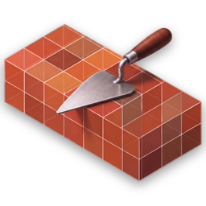
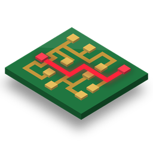
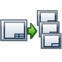
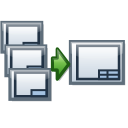
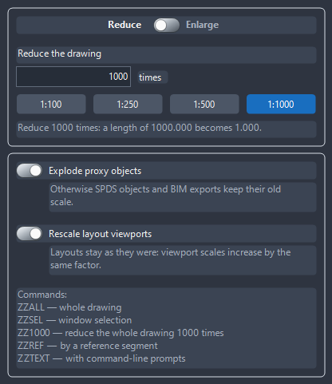
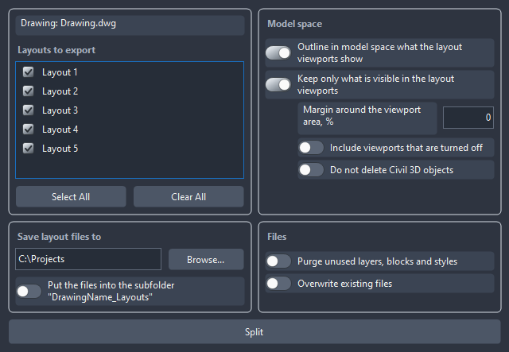
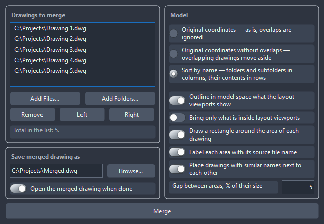

<div align="center">


# ZoomZoom (Зум-зум)

**Drawing rescaling, layout splitting and drawing merging for AutoCAD and Civil 3D**

[Русский](README.md) · [**English**](README.en.md)

[](https://github.com/zaycsev/ZoomZoom/releases/latest)
[](https://github.com/zaycsev/ZoomZoom/releases)
[](LICENSE)
[](https://github.com/zaycsev/ZoomZoom)

</div>

---

**ZoomZoom** is an add-in for **AutoCAD** and **AutoCAD Civil 3D**: eight ribbon
buttons on the **Add-ins** tab and two sets of tools.

- **Rescaling** — bring a drawing from a design scale such as 1:1000 to 1:1 (any scale
  ratio is supported) keeping proportions in model and on layouts: dimensions show the
  same numbers on the same extension lines, while text, ticks, linetypes, annotative
  objects, multileaders, tables and viewports stay as they were.
- **Sheets and drawings** — split a drawing into one file per layout, merge several
  drawings into one, move model objects together with the viewports that show them,
  highlight in model space everything the viewports show.

Why rescale? To overlay a drawing on a point cloud or a total-station survey, which are
1:1.

Before: a dimension reads `1000` and the polyline between the same points is `1000`
long. After: the dimension still reads `1000`, the polyline is `1.000` long.

Works in **AutoCAD and Civil 3D 2015 and later**. The installer ships three builds:
.NET Framework 4.5 for 2015–2018, .NET Framework 4.7 for 2019–2024 and .NET 8 for
2025+. It installs per-user without administrator rights.

**Interface language** is chosen during setup: the first installer window offers
Русский or English (the Windows language is preselected). The chosen language is used
both by the setup wizard and by the ZoomZoom ribbon buttons, palettes and dialogs in
AutoCAD. Command-line messages and reports are in Russian. Without the installer
(`deploy.ps1`) the language follows AutoCAD: English in English AutoCAD, Russian
otherwise. A detailed description of how
rescaling, viewports, splitting and merging work is in [docs/GUIDE.md](docs/GUIDE.md) (Russian).

## Ribbon buttons

| Icon | Button | What it does |
|:-:|---|---|
|  | **Whole Drawing**<br>`ZZALL` | Rescales the whole current space with the palette settings, including objects on frozen and turned-off layers. |
|  | **Window**<br>`ZZSEL` | The same, but only for objects selected with a window (and for hidden layers inside the same window). |
|  | **Reference**<br>`ZZREF` | Scale by a reference segment: pick its two points, then the new position of the second one (the first stays put) or type a length. |
|  | **Settings**<br>`ZZ` | Palette: scale factor and proxy object explosion. |
|  | **Highlight Viewports**<br>`DWGVIEWS` | Outline in model space everything the layout viewports show. Clicking again erases the previous outlines and draws new ones. |
|  | **Move with Viewport**<br>`DWGMOVEVP` | Move model objects like the `MOVE` command and shift the viewports that show them by the same distance, so the layouts keep showing the same thing. |
|  | **Split by Layouts**<br>`DWGSPLIT` | Save every layout of the drawing to a separate DWG file. |
|  | **Merge into One**<br>`DWGMERGE` | Merge several multi-layout drawings into one DWG. |

If the workspace has no Add-ins tab, the panel gets its own "Зум-зум" tab. The panel
comes back after a workspace switch and after `RIBBONCLOSE` / `RIBBON`.

## Features

All ZoomZoom windows are modeless AutoCAD palettes: keep them open, dock them to a
screen edge or collapse them while working in the drawing. Colours follow the AutoCAD
theme (dark or light) on the fly, sizes follow Windows scaling.

### Rescale settings

Opened by the **Settings** button or the `ZZ` command. **Whole Drawing** and **Window**
rescale with what is set here.



- **Reduce / Enlarge** — direction: from 1:1000 to 1:1, or back from 1:1 to 1:1000.
- **Reduce the drawing … times** — any number greater than 0 and not 1, with a dot or a
  comma (e.g. `1000` or `304.8`). The **1:100**, **1:250**, **1:500**, **1:1000** buttons
  fill in common scales. The hint below shows the result: "a length of 1000 becomes 1".
- **Explode proxy objects** — otherwise SPDS GraphiCS objects and BIM exports keep their old scale.
- **Rescale layout viewports** — viewport scales change by the same factor, so layouts
  stay as they were (including `_VPCLIP` clipping, twisted views and locked viewports).
- At the bottom — a reminder of the run commands.
- **Settings are remembered**: every change is written to `%APPDATA%\ZoomZoom\settings.ini`
  and survives restarts, reinstalls and updates. First run defaults: reduce 1000 times,
  explode proxies, rescale viewports.

After rescaling, a report on the command line lists what was processed and what was left
as is. Revit dimensions are converted to native AutoCAD dimensions that look the same.

### Split by Layouts

Opened by the **Split by Layouts** button or the `DWGSPLIT` command. Every layout of the
drawing is saved to its own DWG.



- **Drawing and layouts to export** — the palette follows the active drawing: switch
  drawings, add or rename a layout and the list updates. Tick the layouts you need;
  **Select All** / **Clear All** for all at once.
- **Save layout files to** — the drawing's own folder by default. Type or paste a path, or pick
  one with **Browse...**; a missing folder is created. **Put the files into the subfolder
  "DrawingName_Layouts"** keeps the files apart from the source.
- **Model space**:
  - **Outline in model space what the layout viewports show** — each file gets an outline of
    the visible area following the real viewport shape, on its own non-plotting layer;
  - **Keep only what is visible in the layout viewports** — each file gets only the part of the
    model its layout needs; turn off to keep the whole model;
  - **Margin around the viewport area, %** — widen the selection if objects on the frame
    edge matter;
  - **Include viewports that are turned off** — ignored by default;
  - **Do not delete Civil 3D objects** — keeps alignment, profile and surface links at
    the cost of heavier files.
- **Files**: **Purge unused layers, blocks and styles** — smaller files; **Overwrite
  existing files** — otherwise `_2`, `_3` is appended.
- The **Split** button runs as a regular AutoCAD command, so it can be undone.

### Merge into One

Opened by the **Merge into One** button or the `DWGMERGE` command. Several multi-layout
drawings are merged into one DWG with all their layouts.



- **Drawings to merge** — **Add Files...** or **Add Folders...** (with subfolders).
  **Left** / **Right** change the order — the layout tabs of the result follow it.
  **Remove** drops the selected ones. The list stays while the palette is open: adjust
  a setting and merge again.
- **Model** — how the models are placed:
  - **Original coordinates — as is** — overlaps are ignored;
  - **Original coordinates without overlaps** — an overlapping part moves just
    enough to clear;
  - **Sort by name** — folders and subfolders in columns, their contents in rows, by the
    grid axes in file names: one place's whole history reads top to bottom.
- Model layout options: **outline what the viewports show**, **bring only what the
  viewports show**, **outline each drawing with a rectangle**, **label each part with its
  source file name**, **place similarly named drawings side by side** and the **gap
  between parts** as a percentage of size.
- **Save merged drawing as** — the target path and **Open the merged drawing when done**.
- Same-named layers, styles and blocks from different drawings do not clash: identical
  ones are shared, different ones get the file name appended. Layout viewports travel
  with their model parts.

## Commands

| Command | Short | What it does |
|---|---|---|
| `ZOOMZOOM` | `ZZ` | Rescaling settings palette |
| `ZOOMZOOMALL` | `ZZALL` | Rescale the whole current space |
| `ZOOMZOOMSEL` | `ZZSEL` | Rescale the window selection |
| `ZOOMZOOMREF` | `ZZREF` | Rescale by a reference segment |
| `ZOOMZOOM1000` | `ZZ1000` | Divide by 1000 without questions |
| `ZOOMZOOMASK` | `ZZASK` | Everything via command-line prompts instead of the palette |
| `ZOOMZOOMDIMS` | `ZZDIMS` | Convert Revit dimensions to AutoCAD dimensions without rescaling |
| `DWGVIEWS` | | Highlight what layout viewports show |
| `DWGMOVEVP` | | Move objects together with viewports |
| `DWGSPLIT` | | "Split by layouts" palette |
| `DWGSPLITALL` | | Split all layouts with default settings |
| `DWGMERGE` | | "Merge into one" palette |

## Installation

1. Download `Setup_ZoomZoom_v1.1.1.exe` from the
   [latest release](https://github.com/zaycsev/ZoomZoom/releases/latest).
2. Close AutoCAD, run the installer, choose the language (**English** or **Русский**),
   click **Next → Install → Finish**. The plugin
   installs to `%APPDATA%\Autodesk\ApplicationPlugins\ZoomZoom.bundle` — no
   administrator rights required.
3. Start AutoCAD or Civil 3D. The **Зум-зум** panel appears on the **Add-ins** tab.

AutoCAD picks the build that matches its version from the bundle.

## Uninstall

Windows Settings → *Apps* (or Control Panel → *Programs and Features*) →
**Зум-зум для AutoCAD и Civil 3D** → Uninstall.

## Building from source

Requirements: **.NET SDK 8+**, **Inno Setup 6**, and an installed **AutoCAD / Civil 3D
2019–2024** (its managed assemblies are needed for the .NET Framework 4.7 build; the
2015–2018 and 2025+ builds use the official Autodesk NuGet packages).

```powershell
# all three builds + the installer dist\Setup_ZoomZoom_v1.1.1.exe
.\build-installer.ps1 -Version "1.1.1"

# build and install for yourself only (AutoCAD must be closed)
.\deploy.ps1
```

AutoCAD / Civil 3D managed assemblies are referenced from the installed product or
NuGet and are never redistributed.

## License

Released under the **GNU General Public License v3.0**, with an additional permission
(GPLv3 §7) allowing linking against the proprietary Autodesk AutoCAD / Civil 3D
libraries, and additional §7 terms on preserving author attribution. See
[LICENSE](LICENSE) for the full text.

Copyright (C) 2026 zaycsev
