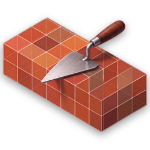
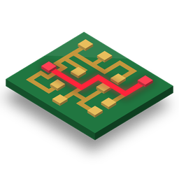
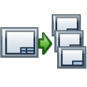
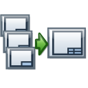
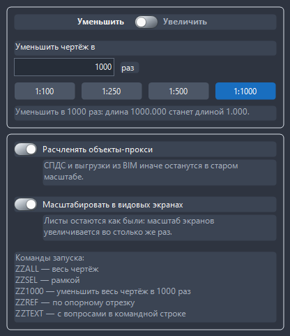
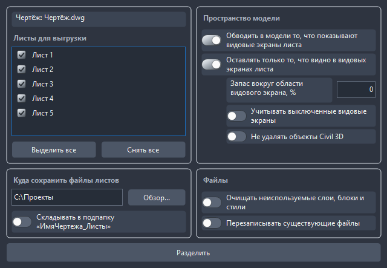
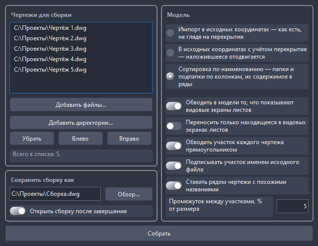

<div align="center">


# Зум-зум (ZoomZoom)

**Масштабирование, разделение по листам и сборка чертежей для AutoCAD и Civil 3D**

[**Русский**](README.md) · [English](README.en.md)

[](https://github.com/zaycsev/ZoomZoom/releases/latest)
[](https://github.com/zaycsev/ZoomZoom/releases)
[](LICENSE)
[](https://github.com/zaycsev/ZoomZoom)

</div>

---

**Зум-зум** — надстройка для **AutoCAD** и **AutoCAD Civil 3D**: восемь кнопок на ленте во вкладке **Надстройки** и два набора инструментов.

- **Масштабирование** — привести чертёж из «проектировочного» масштаба 1:1000 к 1:1 (поддерживается любое соотношение масштабов) с сохранением пропорций в модели и на листах: размеры измеряют прежние числа на тех же выносных линиях, текст, засечки, пунктиры, аннотативные объекты, мультивыноски, таблицы и видовые экраны — в исходном виде для совмещения со съёмкой тахеометра
Было: размер показывает `1000`, полилиния между теми же точками имеет длину `1000`. Стало: размер по-прежнему показывает `1000`, а полилиния — длину `1.000`.
- **Листы и чертежи** — разделить чертёж по листам на отдельные файлы, собрать несколько чертежей в один, перенести объекты модели вместе с видовыми экранами, подсветка в модели всего того, что показывают видовые экраны.


Работает в **AutoCAD и Civil 3D 2015 и новее**. Установщик содержит три сборки: .NET Framework 4.5 для 2015–2018, .NET Framework 4.7 для 2019–2024 и .NET 8 для 2025+. Ставится для текущего пользователя без прав администратора.

**Язык интерфейса** выбирается при установке: в первом окне установщика — «Русский» или «English» (заранее выбран язык Windows). На выбранном языке будут и мастер установки, и кнопки ленты, палитры и окна Зум-зума в AutoCAD. Сообщения в командной строке и отчёты — на русском. Без установщика (`deploy.ps1`) язык берётся от AutoCAD: английский в английском AutoCAD, русский в остальных.

Подробно — как устроено масштабирование, видовые экраны, разделение и сборка чертежей — в [docs/GUIDE.md](docs/GUIDE.md).

## Кнопки на ленте

| Значок | Кнопка | Что делает |
|:-:|---|---|
|  | **Весь чертёж**<br>`ZZALL` | Масштабирует всё текущее пространство по настройкам палитры. Берёт и то, что лежит на замороженных и выключенных слоях. |
|  | **Рамка**<br>`ZZSEL` | То же самое, но только для объектов, выбранных рамкой (и для скрытых слоёв в той же рамке). |
|  | **Отрезок**<br>`ZZREF` | Масштаб по опорному отрезку: две точки отрезка, затем новое положение второй (первая остаётся на месте) или длина числом. |
|  | **Настройки**<br>`ZZ` | Палитра: коэффициент масштабирования и расчленение прокси. |
|  | **Подсветить экраны**<br>`DWGVIEWS` | Обвести в модели всё, что показывают видовые экраны листов. Повторное нажатие стирает прежние рамки и обводит заново. |
|  | **Передвинуть с видовым**<br>`DWGMOVEVP` | Перенести объекты модели с сохранением отображения в видовых экранах, аналогично команде `ПЕРЕНЕСТИ`, и соответственно сдвинуть видовые экраны, в которых отображается перенесённое. |
|  | **Разделить по листам**<br>`DWGSPLIT` | Сохранить каждый лист чертежа в отдельный файл DWG. |
|  | **Собрать в один**<br>`DWGMERGE` | Сборка нескольких многолистовых чертежей в один DWG. |

Если в рабочем пространстве нет вкладки «Надстройки», панель встаёт на собственную вкладку «Зум-зум». Панель возвращается на место после смены рабочего пространства и после `RIBBONCLOSE` / `RIBBON`.

## Функционал

Все окна Зум-зума — немодальные палитры AutoCAD: их можно держать открытыми, пристыковать к краю экрана или свернуть, продолжая работать в чертеже. Цвета подстраиваются под тему AutoCAD (тёмная или светлая) на лету, размеры — под масштаб Windows.

### Окно настроек масштабирования

Открывается кнопкой **Настройки** или командой `ZZ`. Кнопки **Весь чертёж** и **Рамка** масштабируют по тому, что выставлено здесь.



- **Уменьшить / Увеличить** — направление: из 1:1000 в 1:1 или обратно, из 1:1 в 1:1000.
- **Уменьшить чертёж в … раз** — любое число больше 0 и не равное 1, с точкой или запятой (например, `1000` или `304,8`). Кнопки **1:100**, **1:250**, **1:500**, **1:1000** подставляют частые масштабы. Под полем сразу видно, что получится: «длина 1000 станет длиной 1».
- **Расчленять объекты-прокси** — СПДС GraphiCS и выгрузки из BIM иначе останутся в старом масштабе.
- **Масштабировать в видовых экранах** — масштаб видовых экранов пересчитывается во столько же раз, и листы остаются как были (с учётом подрезки `_VPCLIP`, поворота вида и заблокированных экранов).
- Внизу — памятка с командами запуска.
- **Настройки запоминаются**: каждое изменение сразу пишется в `%APPDATA%\ZoomZoom\settings.ini` и переживает перезапуск, переустановку и обновление. При первом запуске — уменьшить в 1000 раз, прокси расчленять, экраны пересчитывать.

После масштабирования в командной строке выводится отчёт: что обработано и что оставлено как есть. Размеры из Revit заодно переводятся в обычные размеры AutoCAD того же вида.

### Разделить по листам

Открывается кнопкой **Разделить по листам** или командой `DWGSPLIT`. Каждый лист чертежа сохраняется в отдельный DWG.



- **Чертёж и листы для выгрузки** — окно само следит за активным чертежом: переключили чертёж, добавили или переименовали лист — список обновится. Флажками выбираются нужные листы, кнопки **Выделить все** / **Снять все** — для всех разом.
- **Куда сохранить файлы листов** — по умолчанию папка самого чертежа. Путь можно вписать, вставить из проводника или выбрать кнопкой **Обзор...**; несуществующая папка будет создана. Флажок **Складывать в подпапку «ИмяЧертежа_Листы»** — чтобы файлы не смешивались с исходником.
- **Пространство модели**:
  - **Обводить в модели то, что показывают видовые экраны листа** — в каждом файле появляется контур видимой области по настоящей форме экрана, на отдельном слое, не печатается;
  - **Оставлять только то, что видно в видовых экранах листа** — в файл попадает только нужная листу часть модели; выключите, чтобы сохранить модель целиком;
  - **Запас вокруг области видового экрана, %** — расширить область отбора, если важны объекты на границе кадра;
  - **Учитывать выключенные видовые экраны** — по умолчанию они не учитываются;
  - **Не удалять объекты Civil 3D** — сохраняет связи трасс, профилей и поверхностей ценой более тяжёлых файлов.
- **Файлы**: **Очищать неиспользуемые слои, блоки и стили** — меньше размер файлов; **Перезаписывать существующие файлы** — иначе к имени добавляется `_2`, `_3`.
- Кнопка **Разделить** запускает работу обычной командой AutoCAD — её можно отменить.

### Собрать в один

Открывается кнопкой **Собрать в один** или командой `DWGMERGE`. Несколько многолистовых чертежей собираются в один DWG со всеми листами.



- **Чертежи для сборки** — **Добавить файлы...** или **Добавить директории...** (вместе с подпапками). **Влево** / **Вправо** меняют порядок: в этом порядке встанут вкладки листов в сборке. **Убрать** — исключить выделенные. Список сохраняется, пока открыта палитра: можно поправить настройку и собрать заново.
- **Модель** — как раскладывать модели собранных чертежей:
  - **Импорт в исходных координатах** — как есть, не глядя на перекрытия;
  - **В исходных координатах с учётом перекрытия** — наложившийся участок отодвигается ровно настолько, чтобы разойтись;
  - **Сортировка по наименованию** — папки и подпапки по колонкам, их содержимое в ряды, по осям из имён файлов: по вертикали читается вся история одного места.
- Оформление модели: **обводить то, что показывают видовые экраны**, **переносить только видимое в видовых экранах**, **обводить участок каждого чертежа прямоугольником**, **подписывать участок именем исходного файла**, **ставить рядом чертежи с похожими названиями** и **промежуток между участками** в процентах от размера.
- **Сохранить сборку как** — путь к итоговому файлу, флажок **Открыть сборку после завершения**.
- Одноимённые слои, стили и блоки разных чертежей не смешиваются: одинаковые объединяются, разные получают приписку с именем файла. Видовые экраны листов едут вместе со своими участками модели.

## Команды

| Команда | Коротко | Что делает |
|---|---|---|
| `ZOOMZOOM` | `ZZ` | Палитра настроек масштабирования |
| `ZOOMZOOMALL` | `ZZALL` | Масштабировать всё текущее пространство |
| `ZOOMZOOMSEL` | `ZZSEL` | Масштабировать выбранное рамкой |
| `ZOOMZOOMREF` | `ZZREF` | Масштаб по опорному отрезку |
| `ZOOMZOOM1000` | `ZZ1000` | Разделить на 1000 без вопросов |
| `ZOOMZOOMASK` | `ZZASK` | Всё вопросами в командной строке, мимо палитры |
| `ZOOMZOOMDIMS` | `ZZDIMS` | Перевести размеры Revit в размеры AutoCAD без масштабирования |
| `DWGVIEWS` | | Подсветить в модели то, что видно в видовых экранах |
| `DWGMOVEVP` | | Перенести объекты вместе с видовыми экранами |
| `DWGSPLIT` | | Палитра «Разделить по листам» |
| `DWGSPLITALL` | | Все листы сразу с настройками по умолчанию |
| `DWGMERGE` | | Палитра «Собрать в один» |

## Установка

1. Скачайте `Setup_ZoomZoom_v1.1.1.exe` из [последнего релиза](https://github.com/zaycsev/ZoomZoom/releases/latest).
2. Закройте AutoCAD, запустите установщик, выберите язык (**Русский** или **English**) и нажмите **Далее → Установить → Готово**. Плагин ставится в `%APPDATA%\Autodesk\ApplicationPlugins\ZoomZoom.bundle` — права администратора не нужны.
3. Запустите AutoCAD или Civil 3D. Панель **Зум-зум** появится во вкладке **Надстройки**.

AutoCAD сам выбирает из бандла сборку под свою версию.

## Удаление

Параметры Windows → _Приложения_ (или Панель управления → _Программы и компоненты_) → **Зум-зум для AutoCAD и Civil 3D** → Удалить.

## Сборка из исходников

Требуется: **.NET SDK 8+**, **Inno Setup 6** и установленный **AutoCAD / Civil 3D 2019–2024** (его управляемые сборки нужны для сборки под .NET Framework 4.7; для 2015–2018 и 2025+ API берётся из официальных пакетов Autodesk в NuGet).

```powershell
# все три сборки + установщик dist\Setup_ZoomZoom_v1.1.1.exe
.\build-installer.ps1 -Version "1.1.1"

# только собрать и поставить себе (AutoCAD должен быть закрыт)
.\deploy.ps1
```

Управляемые сборки AutoCAD / Civil 3D берутся из установленного продукта или NuGet и вместе с плагином не распространяются.

## Лицензия

Распространяется по **GNU General Public License v3.0** с дополнительным разрешением (GPLv3 §7), допускающим линковку с проприетарными библиотеками Autodesk AutoCAD / Civil 3D, и дополнительными условиями §7 о сохранении указания авторства. Полный текст — в файле [LICENSE](LICENSE).

Copyright (C) 2026 zaycsev
